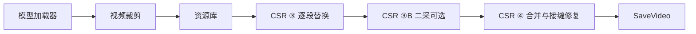

# comfyui-AICG3D-CSR 功能总览

> 一条线，把“裁切、分段、替换、断点续跑、二采、音轨后封装、接缝修复”组织成可恢复的视频生产流水线。

本文使用“CSR 差异化亮点”描述项目的组合设计与工程取舍，不主张市场排他，也不声称“全球唯一”。开源生态和第三方模型变化很快，实际能力以本仓库当前版本、依赖环境和测试结果为准。

## 1. 项目定位

`comfyui-AICG3D-CSR` 是面向 ComfyUI 与 MiniMax H3 工作流的独立人物、场景、物品和产品替换节点包。它把长视频替换中常见的离散操作整合为一条单线工作流：



整条链只使用单一任务数据输出，节点之间保持单线连接，减少多分支工作流中的断线、错连和参数不一致。

## 2. 核心吸引力

### 2.1 单线生产链

- 模型包、视频任务包、素材任务包、分段结果和最终视频各自使用明确的数据类型。
- 默认工作流每个处理节点只有一个输出口。
- 视频裁剪与素材资源库拆分后，不再把所有操作堆在一个超长节点中。
- 仍保留旧版合并节点用于历史工作流兼容，但新项目推荐使用独立视频裁剪和资源库节点。

### 2.2 长视频分段替换闭环

- 源视频只上传一次。
- 可先设置目标时长，再用滑块移动目标窗口。
- 窗口内部可以继续自由分段。
- 每段生成后立即保存 MP4，不需要等全部任务结束才落盘。
- 已完成分段支持断点识别与续跑。
- 上下文帧只用于跨段衔接，不会重复进入最终成片。
- 最终合并会统一帧率、时间基线和编码参数。

### 2.3 音频独立流水线

这是 CSR 工作流最重要的工程差异之一：

1. 上传视频后立即剥离完整音轨。
2. 音轨保存为独立的 48 kHz、双声道、PCM 16-bit WAV。
3. 所有生成分段都保持无音轨。
4. 真实波形不参与每段视频的重复采样、编码和拼接。
5. 全部分段完成并合并为完整视频后，最后一步才封装 AAC 音轨。

这种方式减少了音频重复处理和逐段时间戳错误的机会，也让分段视频本身更容易复用。

### 2.4 可选二采，而不是强制二采

- `CSR ③B` 默认关闭并直接透传。
- 打开后才展开模型、LoRA、3D Latent 放大、倍率、设备、精度、分块、采样器、调度器、步数、denoise 和 seed。
- 二采分段拥有独立缓存、保存目录和断点续跑。
- 二采会按新分辨率重建参考条件，避免直接拉伸一采条件。
- 不需要二采时，不增加额外图分支，也不改变原有单线结构。

### 2.5 跨段曝光锁定与接缝修复

分段模型常见的问题不是编码接缝，而是每段生成后的曝光或色温基线不同。CSR ④ 提供：

- 跨段曝光基线跟随；
- 新段开头前 12 帧的低频光影匹配；
- 加性亮度渐进入段；
- 同镜头下的单帧运动桥接；
- 硬切镜头自动保护；
- 接缝报告和边界差分检查；
- 原始帧流式送入最终 FFmpeg 编码，减少中间编码损失；
- 音轨只在完整视频生成后封装。

该功能用于降低常见曝光闪烁和边界跳变，不承诺修复所有模型级身份漂移、动作错误或结构性失败。

### 2.6 实时进度与分段预览

- 在 `CSR ③` 下方显示当前段、采样步数、整体进度、已用时间和剩余时间。
- 可从采样预测中解码实时预览。
- 每段生成完成后自动切换到已保存的 MP4。
- 实时预览显示约略结果，最终以保存分段为准。
- 可配置预览频率和预览分辨率，在速度与清晰度之间取舍。

## 3. 视频裁剪节点

### 3.1 任意目标窗口

- 支持自定义目标时长。
- 支持 5 秒、10 秒、15 秒快捷按钮。
- 支持任意时间窗口移动。
- 支持均分、按 3.75 秒推荐、添加和删除分段。
- 相邻段落必须首尾相接，UI 会阻止重叠和缺口。

### 3.2 输出分辨率与宽高比

分辨率与宽高比放在同一行：

| 分辨率 | 宽高比 | 示例输出 |
|---|---|---|
| 540P | 16:9 | 960×540 |
| 540P | 9:16 | 540×960 |
| 720P | 16:9 | 1280×720 |
| 1080P | 16:9 | 1920×1080 |
| 自定义 | 自定义宽高 | 精确交付尺寸 |

支持的宽高比包括：

- 跟随源视频
- 16:9
- 16:10
- 9:16
- 1:1
- 4:3
- 3:4
- 21:9

模型画布始终向上取整到 32 像素块，并实时显示在节点底部。例如 `960×540` 会使用 `960×544` 的模型画布，最终仍交付精确的 `960×540`。模型画布不会小于请求的输出画布。

当目标宽高比与源视频不一致时，系统会按目标尺寸放大填充并居中裁切，避免直接拉伸。

## 4. 资源库节点

### 4.1 默认四卡槽

默认只显示四张卡：

- `替换物 1`
- `替换物 2`
- `背景替换`
- `参考 / 首帧`

点击 `+` 可继续添加替换物，最多显示 7 个替换物。加上背景和参考帧，全部图片参考正好不超过 H3 的 9 张图像上限。

### 4.2 人物、物品和产品共用替换槽

每个替换物槽可选择：

- 人物
- 物品/产品/道具/背包

这样不需要为人物和产品维护两套完全不同的节点。

### 4.3 完整缩略图

上传图片会显示为完整缩略图，不裁掉头部、产品边缘或背包轮廓，便于上传后直接确认素材。

### 4.4 背景替换与参考帧行为

- 背景图使用独立槽位。
- 使用背景替换时，旧参考首帧不会继续锁住原环境。
- 相关环境冲突处理在后台执行，不在节点底部显示提示文案。

## 5. 模型加载器

- 独立于原 `comfyui-AICG3D` 插件。
- 支持 FL2VA 与 Ref2VA 模式。
- 支持分别选择 FL2VA 和 Ref2VA 主模型。
- 支持文本编码器、视频 VAE、音频 VAE。
- 提供 8 个 LoRA 槽位。
- LoRA 选择器支持滚动浏览。
- 每个 LoRA 有独立启用开关；关闭开关不会清空选择的 LoRA 和权重。
- 所有模型与 LoRA 由用户本地环境提供，仓库不附带权重。

## 6. 替换提示词系统

### 6.0 四大便捷替换 Skill

- `单人替换`：只替换一个指定人物，其他人物与背景保持不变。
- `多人替换`：多个替换物与多个目标人物一一绑定，防止串脸、漏换和新增人物。
- `商品替换`：锁定商品轮廓、材质、包装、LOGO 和接触关系。
- `背景/场景替换`：强制完整环境替换，而不是调色或局部修补。

四个 Skill 会在 `CSR ③` 的替换标签菜单中优先显示，数据源为 [replacement_skills.json](../skills/replacement_skills.json)。

### 6.1 本地提示词优化器

- 支持 Ollama、LM Studio、llama.cpp server、LocalAI 等 OpenAI 兼容本地 API。
- 可选使用 `llama-cpp-python` 直接加载 GGUF 模型。
- 提供背景彻底替换、场景结构重建、人物替换、物品替换、组合替换和失败修复方案。
- 生成结果先预览，再由用户决定是否写入描述。
- 强制约束层会追加背景删除、旧场景清除和前景保持规则。
- 视觉分析默认关闭；关闭时完全不读取视频或图片。
- 可主动开启视觉分析，从上游读取目标段首/中/尾帧和最多 3 张参考图，总计不超过 6 张 512px 低清图片。
- API 模式可单独指定视觉模型；本地 GGUF 模式可选择与主模型匹配的 `mmproj` 视觉投影。
- 配置保存在本地 ComfyUI 用户目录，接口不会返回明文 API Key。

详细配置见 [prompt-optimizer.md](prompt-optimizer.md)。


CSR ③ 提供替换标签：

- 人物替换
- 背景/场景替换
- 物品/产品替换
- 人物 + 背景
- 人物 + 物品
- 人物 + 背景 + 物品
- 自定义

选择标签只记录任务类型；点击“应用模板”后才会写入描述框，避免切换标签时覆盖用户手工改写的提示词。

详细模板见 [replacement-prompts.md](replacement-prompts.md)。

## 7. 断点续跑与缓存

- 一采分段独立保存。
- 二采分段独立保存。
- 保存文件同时记录帧数、摘要和 SHA-256 校验值。
- 再次执行时只复用满足当前参数摘要的完整分段。
- 修改模型、提示词、分辨率、步数、采样器或 seed 等关键参数会改变摘要。
- 断点缓存用于节省重复计算，不代表对生成结果作质量担保。

## 8. 输出与诊断

典型输出目录：

```text
ComfyUI/output/AICG3D-CSR/
  source_<digest>/
    source_audio.wav
    normalized.mp4
    plan.json
  job_<digest>/
    segments/
      segment_00000.mp4
      segment_00000.json
      ...
    second_pass/
      job_<digest>/
        segments/
    progress.json
    run_report.json
    second_pass_report.json
    merge_report.json
    final_seamless.mp4
```

报告包括：

- 分段状态和断点复用状态；
- 帧数与持续时间；
- 输出尺寸；
- 音频是否为后置封装；
- 接缝亮度差；
- 硬切保护状态；
- 低频光影差与运动桥权重；
- 边界相邻帧差异。

## 9. 兼容性与工程约束

- 公共节点类使用 `CSR` 前缀。
- 前端扩展使用 `AICG3D.CSR.*` 命名空间。
- 插件路由使用 `/aicg3d_csr/` 命名空间。
- 不全局修改 ComfyUI 节点、采样器、注意力后端或画布行为。
- 上传路径限制在 ComfyUI 的 `input`、`output`、`temp` 目录内。
- 支持传统画布与 Nodes 2.0 的 DOM 高度同步。
- 依赖 `numpy` 与 `filelock`，并在 `requirements.txt` 和 `pyproject.toml` 中一致声明。
- 适配的 MIT 第三方代码及完整许可文本见 [THIRD_PARTY_NOTICES.md](../THIRD_PARTY_NOTICES.md)。

## 10. 适合的场景

- 人物替换与动作迁移；
- 背景或场景替换；
- 产品、道具、背包等物品替换；
- 人物与背景组合替换；
- 需要分段生成的长视频；
- 需要中途暂停、恢复和逐段检查的制作任务；
- 需要一采后选择性二采放大的工作流；
- 需要把音轨从生成分段中完全剥离的流水线；
- 需要最终统一帧率、尺寸、编码和音轨的交付任务。

## 11. 能力边界

CSR 不会自动替用户解决以下问题：

- 输入视频、图片、肖像、音乐和商标的权利来源；
- 第三方模型、LoRA、VAE、放大器和人脸检测模型的许可；
- 生成模型的随机性、身份漂移、手指错误、口型错误或动作失败；
- 复杂多人场景中的身份竞争；
- 所有镜头切换都能自动识别；
- 所有接缝都绝对不可见；
- 生成内容的事实准确性；
- 使用生成内容进行欺诈、冒充、骚扰、虚假代言或其他违法活动；
- 将输出直接用于法律、医疗、金融、身份认证、安防或其他高风险决策。

## 12. 推荐使用方式

1. 先用 480P 或 540P、短时间窗口和低步数测试。
2. 确认人物、背景或产品替换方向正确。
3. 再提升分辨率或启用二采。
4. 保留 `resume_completed`，避免意外中断后重做全部片段。
5. 多人物任务优先拆成多个顺序替换节点。
6. 正式发布前逐段和最终成片均人工复核。
7. 对真实人物、品牌、音乐和影视素材先取得必要授权。

## 13. 法律与合规

使用前请阅读：

- [法律声明与可接受使用](../LEGAL.md)
- [隐私说明](../PRIVACY.md)
- [安全策略](../SECURITY.md)
- [贡献指南](../CONTRIBUTING.md)
- [第三方声明](../THIRD_PARTY_NOTICES.md)
- [MIT 许可证](../LICENSE)

本文和项目文档不构成法律意见。商业使用、真实人物替换、平台发布或大规模部署前，应根据所在地法律和业务场景咨询合格法律顾问。
